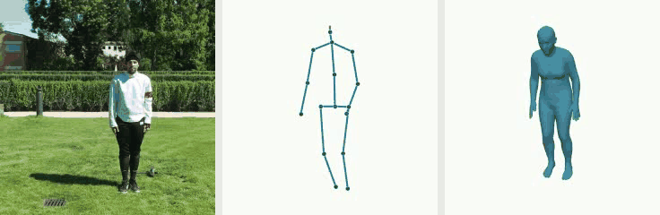
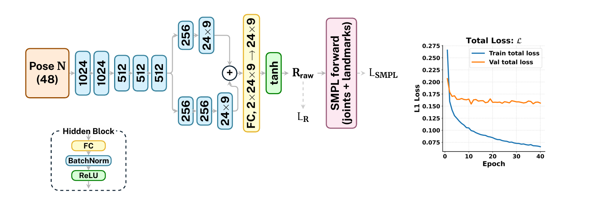
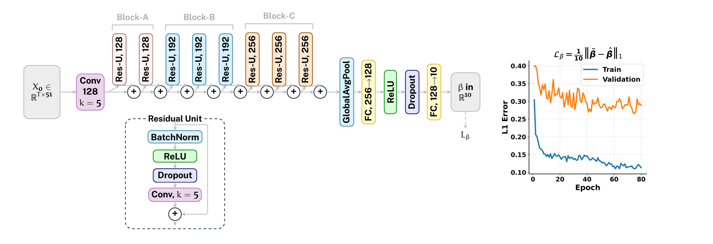

# Video to SMPL

[](assets/fencing_full_pipeline.mp4)

The full 3DPW fencing sequence: input video, root-centred MotionBERT coordinates, and SMPL reconstruction, shown left to right in square panels. Click the animation to open the full 31-second video.

A small inference project extracted from the thesis pipeline:

**Video → AlphaPose (HALPE-26) → MotionBERT (H36M-17) → SMPL pose + shape → optional previews.**

Choose pose and shape independently. No evaluation dataset or ground-truth annotations are needed.

| Option | Implementation |
| --- | --- |
| `--pose kinematic` | Existing MotionBERT/BVH Rodrigues solver, including pelvis orientation and head direction |
| `--pose optimization` | Existing Adam fit of root-centered SMPL H36M joints to MotionBERT joints; neutral shape during pose fitting |
| `--pose learned` | Existing SMPLR-style regressor; requires its trained checkpoint |
| `--shape neutral` | Ten zero shape coefficients |
| `--shape temporal` | Existing residual temporal shape network; overlapping clips predict ten shape coefficients |

## Learned network architectures

### Pose-only SMPLR regressor

The pose network maps 48 root-centred MotionBERT bone-direction values to 24 SMPL joint rotations. It uses the pose-only design shown below, without a shape branch.



### Temporal shape regressor

The shape network processes raw, non-root-centred MotionBERT keypoint sequences and predicts the ten SMPL shape coefficients with an eight-block residual temporal convolutional network.



The project includes recreated learned checkpoints. The pose model is the Figure 3.3 pose-only SMPLR architecture with a 48-dimensional root-centred bone-direction input and no shape branch. The temporal shape model is the Figure 3.4 eight-residual-block Res-TCN: raw non-root-centred 17-joint MotionBERT sequences, 50-frame windows, Rx180 coordinate convention, and a 10-coefficient regression head.

## Setup

The `motionbert` conda environment is the verified environment for this project: Python 3.7, PyTorch 1.13.1 with CUDA, NumPy 1.21.5, SciPy 1.7.3, `smplx` 0.1.28, and Chumpy 0.70. It trains and loads the learned models. Activate the environment, then install this package from the project folder:

```sh
python -m pip install -e . --no-build-isolation
```

Install AlphaPose separately using its own installation instructions. Its Python environment can differ from this package's environment. Obtain a MotionBERT checkout, the HALPE-26 and MotionBERT checkpoints, the licensed neutral SMPL model, and the corresponding H36M-17 joint regressor. The learned pose and temporal shape checkpoints are included; third-party assets are deliberately not bundled.

Copy `configs/example.json` to `configs/local.json` and set the paths. Relative asset paths are resolved from the configuration file's directory. `alphapose_python` is the executable used to launch AlphaPose; set it to the absolute executable path of its environment when necessary. AlphaPose's detector weights must also be installed in its checkout.

Original Chumpy-based SMPL pickles need `chumpy` installed in the package environment. The loader supplies a scoped compatibility shim for their legacy Python/NumPy imports. A SMPL model with plain NumPy arrays does not need Chumpy. Only load model/checkpoint files from trusted sources; these formats use Python serialization.

Validate the selected asset paths:

```sh
video-to-smpl --config configs/local.json --pose learned --shape temporal --check
```

`--check` validates paths, not whether model weights are compatible. Use the supplied checkpoint names and coordinate conventions from `configs/example.json`.

## Process 3DPW from frames

The repository includes the same dataset stages used by the thesis pipeline. They preserve the original 3DPW frame timeline, run AlphaPose on the VIBE-style ground-truth person boxes (so the detector is skipped), insert explicit zero entries for missed poses, and linearly interpolate only gaps bounded by valid detections. MotionBERT then consumes those aligned HALPE-26 tracks using its original `WildDetDataset` preprocessing.

The standard 3DPW preprocessing bundle is detected automatically when it contains these files:

```text
3DPW/
  imageFiles/imageFiles/<sequence>/image_00000.jpg
  preprocessed_train/3dpw_train.npz
  preprocessed_val/3dpw_validation.npz
  preprocessed_test/3dpw_test.npz
```

Run AlphaPose from its own environment. This command processes all three splits; use `--only-sequence` or `--split-filter` for a smaller run. Replace the example paths with your local checkout and weights.

```sh
python scripts/preprocess_3dpw_alphapose.py \
  --dataset-root /data/3DPW \
  --output-root outputs/3dpw \
  --alphapose-repo /models/AlphaPose \
  --alphapose-cfg configs/halpe_26/resnet/256x192_res50_lr1e-3_1x.yaml \
  --alphapose-checkpoint /models/halpe26_fast_res50_256x192.pth
```

Then run MotionBERT from the verified `motionbert` environment:

```sh
python scripts/preprocess_3dpw_motionbert.py \
  --output-root outputs/3dpw \
  --motionbert-repo /models/MotionBERT \
  --motionbert-config configs/pose3d/MB_ft_h36m_global_lite.yaml \
  --motionbert-checkpoint checkpoint/pose3d/FT_MB_lite_MB_ft_h36m_global_lite/best_epoch.bin
```

The generated files are grouped as `predictions/alphapose/<split>/<sequence>/person_<id>` and `predictions/motionbert/<split>/<sequence>/person_<id>`. The AlphaPose folder contains the aligned JSON, `frame_indices_prediction.npy`, `frame_missing_mask_prediction.npy`, and `frame_interpolated_mask_prediction.npy`; MotionBERT writes the aligned `X3D_prediction.npy`. Pass the three `--preprocessed-*` paths explicitly if the VIBE-format metadata lives outside the 3DPW root. The native 3DPW images alone do not contain these exact VIBE tracks.

## Train and evaluate on 3DPW

`run_3dpw_training.py` joins preprocessing, training, and evaluation into one local command. Select `pose` or `shape`; it reuses complete AlphaPose/MotionBERT intermediates under `--pipeline-root`, and creates them for all 3DPW splits when they are absent. The selected checkpoint and `evaluation.json` are written to `--runs-root/<run-name>`.

The original training and evaluation protocol also needs VIBE's 3DPW split databases. They provide the SMPL pose and shape targets and are not included with a raw 3DPW download. Put `3dpw_train_db.npz`, `3dpw_val_db.npz`, and `3dpw_test_db.npz` in one folder and supply it as `--vibe-root`.

```sh
python scripts/run_3dpw_training.py \
  --model pose \
  --dataset-root /data/3DPW \
  --vibe-root /data/vibe_db \
  --pipeline-root outputs/3dpw \
  --runs-root training-runs \
  --run-name pose_3dpw_motionbert \
  --alphapose-python /envs/alphapose/bin/python \
  --motionbert-python /envs/motionbert/bin/python \
  --alphapose-repo /models/AlphaPose \
  --alphapose-cfg /models/AlphaPose/configs/halpe_26/resnet/256x192_res50_lr1e-3_1x.yaml \
  --alphapose-checkpoint /models/AlphaPose/pretrained_models/halpe26_fast_res50_256x192.pth \
  --motionbert-repo /models/MotionBERT \
  --smpl-data-root /models/MotionBERT/data/mesh
```

Use `--model shape` to train the temporal shape network. Defaults follow the recreated runs: pose uses 40 epochs and shape uses 80. `--epochs`, `--batch-size`, `--lr`, `--activation`, and `--cpu` allow local overrides. Add `--force-preprocess` to regenerate intermediates deliberately; otherwise existing outputs are retained.

## Run

For normal video use, first copy `configs/example.json` to `configs/local.json` and fill in the third-party AlphaPose, MotionBERT, and SMPL paths. The learned pose and shape checkpoint paths in the example already point to the included project weights. Then use the concise video command:

```sh
python scripts/infer_video.py input.mp4 --parameters both --config configs/local.json --output outputs/my_video
```

Choose `--parameters pose` to infer the learned SMPL pose with neutral shape, `shape` to infer the learned ten shape coefficients, or `both` to use both stored learned weights. A mesh video is produced by default; use `--visualize 2d 3d mesh` for every preview.

```sh
video-to-smpl input.mp4 --config configs/local.json --pose kinematic --shape neutral --visualize 2d 3d mesh --output outputs/example
```

Switch to the learned methods:

```sh
video-to-smpl input.mp4 --config configs/local.json --pose learned --shape temporal --visualize mesh --output outputs/learned
```

Run the optimization method:

```sh
video-to-smpl input.mp4 --config configs/local.json --pose optimization --shape temporal --output outputs/optimization
```

Use `python -m video_to_smpl` in place of `video-to-smpl` if preferred. `--device cpu` forces CPU inference; `auto` selects CUDA when available. Processing runs locally. Mesh rendering is CPU based and may be slow for long videos.

For faster iteration, reuse raw AlphaPose JSON with `--alphapose-json detections.json`, or start directly from normalized MotionBERT coordinates:

```sh
video-to-smpl --coords outputs/example/motionbert.npy --fps 30 --config configs/local.json --pose optimization --shape neutral --output outputs/refit
```

Every run requires a new or empty output directory. Existing results are never overwritten.

## Outputs

| File | Contents |
| --- | --- |
| `keypoints_2d.npy` | `(T,26,3)` HALPE x, y, confidence; video runs |
| `motionbert.npy` | `(T,17,3)` normalized MotionBERT coordinates |
| `missing_detections.npy` | `(T,)` missing person detections; positions interpolated, confidence stays zero |
| `smpl_params.npz` | `poses (T,72)`, `global_orient (T,3)`, `body_pose (T,69)`, `pose_matrices (T,24,3,3)`, `betas (T,10)`, `transl (T,3)`, `motionbert_root (T,3)`, `frame_indices`, `fps` |
| `vertices.npy` | `(T,6890,3)` pelvis-centered SMPL vertices in model units (meters) |
| `faces.npy` | SMPL triangle indices |
| `smpl_joints.npy` | `(T,17,3)` pelvis-centered regressed joints |
| `preview_2d.mp4` | Keypoints over the input video |
| `preview_3d.mp4` | Root-centered MotionBERT skeleton |
| `preview_mesh.mp4` | Standalone animated SMPL mesh |
| `run.json` | Settings, selected methods, status, timing and diagnostics |

SMPL poses use axis-angle radians. To reproduce every method's mesh exactly, pass `pose_matrices[:, :1]` as global orientation, `pose_matrices[:, 1:]` as body pose, and the exported betas/transl to SMPL with `pose2rot=False`. The learned method preserves its original raw matrix outputs, which are not constrained to proper rotations. Its axis-angle fields are an SVD projection to proper rotations for interoperability and can produce different vertices. The kinematic and optimization methods have equivalent matrix and axis-angle exports.

`transl` centers the SMPL pelvis; it is **not an estimated world trajectory**. Raw MotionBERT root coordinates are saved separately, without pretending that normalized monocular coordinates are metric translation. The mesh preview is a standalone view, not a calibrated video overlay.

## Scope and conventions

- This is a single-person inference pipeline. The default selector starts with the highest-confidence person and follows the closest detection center. It can switch identities during crossings; single-person videos are recommended. `--track-id` selects an ID already present in AlphaPose JSON; the package does not implement a new identity tracker.
- Every video frame is retained. Missing positions are interpolated and marked. Long occlusions remain unreliable.
- MotionBERT input uses full-frame pixel normalization. Its output stays normalized; do not feed pixel-scaled `X3D` files to the trained regressors. Use the same MotionBERT configuration and preprocessing as training.
- The learned pose input's 180-degree x rotation is configurable. Shape preprocessing is configured separately. Defaults reflect the identified thesis methods, but must match the actual checkpoint supplied.
- Pose recovery retains the original method conventions. Shape is estimated independently and applied in the final mesh pass; it does not change the optimization method's neutral-shape pose objective.
- No datasets, videos, licensed body models, or third-party pretrained weights are included. The repository includes the project-specific training and evaluation scripts used to recreate its learned checkpoints.

## Tests

```sh
python -m unittest discover -s tests -v
```

The tests cover timeline preservation, person selection, joint mapping, numerical rotation cases, temporal clip boundaries and output protection. They do not substitute for an end-to-end run with the required models.

## Provenance and publication

The numerical methods and network definitions come from the existing thesis project. The package has no runtime dependency on that project and makes no changes to it.

External dependencies retain their own terms; see `THIRD_PARTY.md`. A project license has not been chosen on the author's behalf. Before publishing, choose an appropriate license and provide compatible trained checkpoints through a separately approved distribution channel. Git ignores local configuration, outputs, videos, weights and body models.
